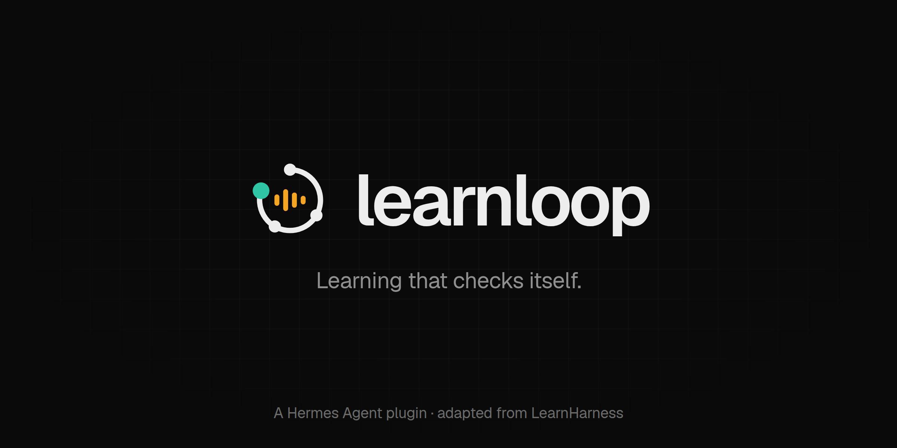

<p align="center"></p>

# learnloop

Ask a chat model to explain something and you'll get a good explanation. You'll nod along, and an hour later you won't be able to explain it back. learnloop turns a Hermes chat into a tutor that checks. It finds out what you already know, plans a path from there, and teaches one graded check at a time. What you learn goes into a knowledge graph you can look at and practise from.

The teaching method comes from [LearnHarness](https://github.com/amosblomqvist/learnharness); learnloop ports it into Hermes as a plugin. See [Credit](#credit-and-licence).

## What it does

A lesson (`/learnloop:study <topic>`) runs in three phases, all in one chat.

1. **Probe.** A few graded questions find where your understanding of each part of the topic starts and stops. The probe only measures. It doesn't teach.
2. **Plan.** You get a diagram of the steps from what you know to the goal. Approve it or ask for changes.
3. **Teach.** Each step is a prediction, the step itself, then a check. Miss a check and you get a smaller question one rung down, then the next one up, until you answer the original yourself. You don't get a wall of explanation.

While a question is open, the message box is for your thinking. Type it, or use Hermes's built-in dictation and talk through your reasoning, then pick an answer. The teacher reads the reasoning as well as the letter and replies to the point where it broke: "your derivation that the variance is $d_k$ was right; where it slipped was going from variance to spread." Each question keeps your answer, your confidence and your thinking, and what you learn is saved as facts linked by the reasoning between them.

Practice (`/learnloop:practice <topic>`) works on what's already in your graph. You get one problem at a time, and the model commits to its own solution before you start. Hints come one rung at a time, from "re-read the second given" up to a worked step, and you only see the solution once the problem is concluded. After each problem the session waits, so you can ask about it; the next one comes when you ask.

The knowledge graph holds every fact you've learned, each linked to the facts it was built from. In Hermes Desktop it's a live graph on the Learn page. You can drag it, search it, tune its physics, and click any fact to practise it.

Recall is experimental and off by default. When it's on, other chats can use up to 6 relevant facts from your graph and say so when they do.

## Install

```bash
hermes plugins install learnloop               # once it's listed in the catalog
hermes plugins install huss-wrld/learnloop     # straight from GitHub
```

Then turn on learnloop's Desktop part in Hermes Desktop: **Capabilities → Plugins → learnloop → enable**, then **Rescan**. Each profile has its own switch. Without the Desktop part learnloop still works, but questions and problems come as text.

You need Hermes 0.23.0 or later. learnloop needs no API keys and has no Python dependencies.

## Use

| Command | What it does |
|---|---|
| `/learnloop:study <topic>` | Start a lesson in this chat |
| `/learnloop:practice <topic>` | Start a practice session in this chat |
| `/learnloop stop` | End the current lesson or practice session |
| `/learnloop status` | This chat's lesson and the size of your graph |
| `/learnloop map` | The lesson plan, with where you are |
| `/learnloop graph [words]` | Search what you've learned |
| `/learnloop recall on\|off` | Let other chats use your graph (off by default) |
| `/learnloop cards on\|off` | Answer cards in Desktop (on by default) |
| `/learnloop import <dir>` | Import a LearnHarness knowledge graph, e.g. `~/.config/LearnHarness/data` |

Telegram and the other messaging platforms don't have plugin skills, so start there with `/learnloop <topic>` or `/learnloop practice <topic>`.

Until you start a lesson or practice session, learnloop stays out of the chat. The one exception is recall, if you turn it on.

## In Hermes Desktop

The open question sits on top of the message box, as in LearnHarness. Pick an option (or *I don't know*) and a confidence, type your thinking in the box, and press Enter. The chat keeps a card for every question; once you've answered, it shows the verdict and the right option, with the explanation behind a *Why* toggle. While a question is open, whatever you type counts as your answer, though slash commands still work.

The lesson pane on the right shows the phase, your progress, a small plan map that opens the full map, and the facts you've learned so far. In a practice chat it lists the problems and how each one went.

The Learn page in the sidebar is where you start lessons and practice, reopen old ones, and explore your graph.

During practice the open problem sits above the message box, and what you type is your thinking. Hint, Set aside and Next problem are one click each.

## Models

The method is hard on the model. It has to hold back during the probe, ask small questions instead of explaining, and ask through the tools instead of typing questions out. I've tested two so far:

- **Claude Opus 5.5** (medium reasoning) followed the method closely. A 15-turn lesson had no hand-typed questions and no tool errors, and it stepped down to smaller questions after misses.
- **DeepSeek V4.1 Flash** ran practice sessions cleanly. In lessons it sometimes typed a question out instead of using the tool; learnloop notices and corrects it on the next turn.

LearnHarness runs three models: a strong one teaches, a cheap one does research and other background jobs, and a vision model reads images and PDFs. Hermes already has a setting for each, and learnloop leaves your config alone:

| Role | Hermes setting |
|---|---|
| Teaching (probe, plan, teach, practice) | the chat's model |
| Background research (`delegate_task`) | `delegation.model` / `delegation.provider` (defaults to the chat's model) |
| Images and figures | `auxiliary.vision` |

When the teacher isn't sure of a fact, it sends research off in the background and keeps teaching. The brief comes back into the chat with its sources.

A stronger model teaches better. In my tests a lesson turn sent about 110k to 125k input tokens and a practice turn about 32k, most of it cached.

## What learnloop touches

learnloop keeps one SQLite database per profile in Hermes's plugin storage, at `<hermes home>/plugin-data/learnloop/learnloop.db`. Graph layout and physics settings live in Desktop's local storage.

It makes no network calls of its own and runs no shell commands. It reads two things outside its own data, both read-only: the folder you give `/learnloop import`, and Hermes's session database, which it uses to follow a lesson when context compression gives the chat a new session id.

It registers four hooks:

- `pre_llm_call` adds learnloop's notes for the turn (phase, open question, method reminders) during lessons and practice. With recall on, it adds up to 6 matching facts in other chats.
- `pre_tool_call` blocks `skill_manage`, `memory` and loading other skills, but only during an active lesson. That stops Hermes's background review from turning a lesson into a competing teaching skill. If the hook fails, the call goes through.
- `transform_llm_output` removes a question the model printed twice.
- `on_session_delete` ends a lesson when its chat is deleted.

During lessons the method tells the model to check uncertain facts with Hermes's own `delegate_task`, a background sub-agent that uses your web tools. learnloop makes no calls itself. Its hook marks the brief when it comes back so it's never graded as your answer.

Its tools are `learn_ask`, `learn_grade`, `learn_phase`, `learn_method`, `learn_record`, `learn_recall`, `learn_problem` and `learn_conclude`. Every one except `learn_recall` refuses to act outside a lesson or practice session.

## Known limits

[docs/known-issues.md](docs/known-issues.md) has the full list, with causes and what would fix them. The ones you're likely to notice:

- learnloop enforces what it can in code: grading before moving on, one open question at a time, the plan before teaching, the pause in practice. How well it teaches still depends on the model.
- A model with shell access can work around a learnloop tool that refuses it. learnloop's guards only cover its own tools.
- Hermes loads plugin tools on demand, so the first call in a session may take an extra step.
- Unit tests cover background research during a lesson (a research result is never graded as your answer), but I haven't checked it in a live lesson yet.

## Compared with LearnHarness, and what's next

The teaching method, question types, question dock, practice doctrine, research jobs, demos and graph clustering all follow LearnHarness. These parts aren't ported yet:

- **Graph extraction.** In LearnHarness a separate pipeline writes the graph: an extractor reads the session, and an auditor links each new idea to an existing one or adds it. In learnloop the teacher records facts itself with `learn_record` when a step lands, and duplicates only merge if they share a name. Porting the extractor and auditor as background `delegate_task` jobs is next.
- **Questions with no right answer**, like "does this plan fit?" (LearnHarness's `ask_user_question`). learnloop asks these in plain chat.
- **Images and files.** LearnHarness can draw explanations, mark up your images with arrows and labels, and read PDFs with its own reader. learnloop uses Hermes's file tools and vision instead.
- **Browsing the graph by lesson** (`list_sessions` / `list_propositions`). learnloop's teacher searches it with `learn_recall` instead.
- **Importing notes files** into the graph. This needs the extraction pipeline first.

## Development

```bash
uvx --with fastapi --with httpx pytest -q tests     # the test suite
hermes plugins validate .                           # catalog checks
python3 tools/build_skill.py                        # regenerate skills/ after editing method/
```

Hermes never loads `tools/` or `tests/`. `tools/drive.py` runs scripted lessons headlessly (`hermes chat` sessions) in a throwaway test profile you name with `DRIVE_PROFILE`, under that profile's own approval settings. `tools/scorecard.py` scores the runs: hand-typed questions, grading order, teaching during the probe, the practice pause, and token use. The research behind the port is in [docs/research](docs/research).

## Credit and licence

The teaching and practice method in `method/` is adapted from **LearnHarness**, Copyright (C) the LearnHarness authors, at commit `713377f366771e3e4730e6acd1bc290e0ebc6d6e`, under AGPL-3.0. Each adapted file's header names its sources and what changed. The practice doctrine is verbatim. The verbatim originals are in `docs/research/method-raw/`. See [NOTICE](NOTICE).

All Python and JavaScript in this repository is original to learnloop.

Copyright (C) 2026 Hussein Al-Amodi. Licensed under the [GNU Affero General Public License v3.0 only](LICENSE).
